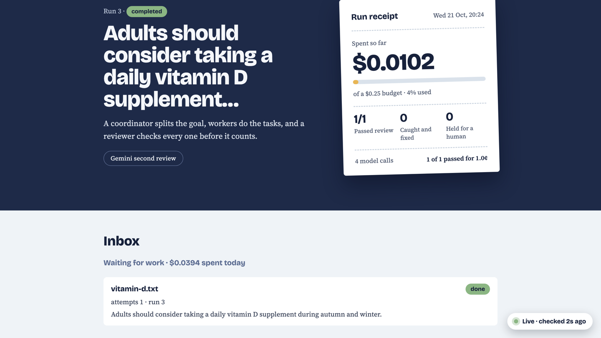

# build-night-crew

Pre-tested starter for Moonfire Build Night (22 Oct 2026): Claude agents with a shared task board, a per-run budget cap and live cost tracking. Work in progress.

On top of that base:
- **Always-on mode:** the crew waits for work in an inbox, wakes only when something arrives, recovers after a restart, and keeps to a daily spending cap.
- **An independent second reviewer:** Gemini re-checks every claim Claude passes, and a claim only counts if both agree.
- **Brief me:** a spoken handover of what the crew did while you were away, written by code from the task board and read by ElevenLabs in two voices.



## Tested end to end (21 and 22 Oct 2026, real API calls)

| What | Result |
|---|---|
| Key check: Claude, Gemini (event key, plus backup model), ElevenLabs | All OK |
| Crew with Gemini as second reviewer, three claims | Gemini agreed on each; when Google returned "high demand", the claim was held as unverified, not passed. Retries and a backup model were added after this. |
| Always-on: a file dropped into `inbox/` | Picked up within seconds, checked, back to waiting (about 1p) |
| Stopped mid-run with Ctrl+C, then restarted | The cut-off run was marked interrupted and the work redone from the start as attempt 2, all three claims passed |
| The same file sent again | Ignored, nothing re-run |
| Two-voice briefing | Played in two voices; wording tightened after listening |
| Challenge mode with Gemini: a mistake planted on purpose | Claude caught it, the worker fixed it on attempt 2, Gemini agreed with the fix |
| `watch.py --gemini --brief`: a file dropped into `inbox/` | Checked in 10 seconds (about 1p), a two-voice briefing appeared in the dashboard's player 9 seconds later and played there |

Precisely what "always-on" means here: the watcher runs on one computer and waits for files in a local folder. It isn't yet deployed as a hosted service; running it in a cloud sandbox is the next step (see the experimental `sparkles` branch).

## Requirements

- [uv](https://docs.astral.sh/uv/) (Python 3.12 is installed automatically)
- Your own Anthropic API key
- Optional: a Gemini API key (a free Google AI Studio key works) for the second reviewer, and an ElevenLabs API key for spoken briefings

## Setup

```bash
git clone https://github.com/Csandal17/build-night-crew.git
cd build-night-crew
uv sync
```

Create a `.env` file in the project folder:

```
ANTHROPIC_API_KEY=your-key-here
GEMINI_API_KEY=optional
ELEVENLABS_API_KEY=optional
```

## Check your setup

```bash
uv run check_keys.py   # one tiny call per key: Claude, Gemini (model and JSON format), ElevenLabs (voices)
```

## Run the crew

```bash
uv run crew.py               # run the evidence crew on the default goal; writes a brief to output/
uv run crew.py --challenge   # plant one known mistake to prove the reviewer catches it
uv run crew.py --challenge --fast-reviewer   # same, with Haiku as the reviewer, to compare cost
uv run crew.py --gemini      # Gemini gives a second, independent review; a claim passes only if both agree
uv run dashboard.py          # open the live dashboard (keep it open while the crew runs)
```

With `--gemini`, Gemini only reviews work Claude has already passed, and never sees Claude's notes. If it disagrees, the worker revises once; if the reviewers still disagree, the claim is held for a human. If Gemini can't be reached, the claim is marked unverified rather than passed. Gemini calls go through the same budget check and cost tracking as Claude's (`gemini.py`).

For a clean demo, delete `board.db` first so the dashboard starts with no old runs.

The source pack lives in `sources/`: one `.txt` file per source, with header lines, then `---`, then the excerpt.

## Always-on mode

```bash
uv run watch.py   # waits for work in inbox/ and wakes the crew when something arrives (Ctrl+C to stop)
```

Plain code does the waiting, so a quiet inbox costs nothing. Drop a `.txt` file with a claim into `inbox/` and the crew picks it up within a few seconds. The same file is never run twice, an edited file counts as new work, and work cut off by a restart is picked up again. A daily cap (`DAILY_BUDGET_USD` in `watch.py`) stops new runs once today's spending can't cover another one.

A three-step demo, with the dashboard open:

```bash
# 1. Start the watcher in one terminal. The dashboard shows it waiting.
uv run watch.py

# 2. In a second terminal, give it work.
echo "Adults should consider taking a daily vitamin D supplement during autumn and winter." > inbox/vitamin-d.txt

# 3. Stop the watcher mid-run with Ctrl+C, start it again, and watch it pick the work back up.
#    Copy the same file under the same name again and nothing new runs.
```

`uv run watch.py --gemini` gives every claim the second review too, and `uv run watch.py --brief` makes a spoken briefing after each piece of work, ready to play on the dashboard. The options combine: `uv run watch.py --gemini --brief`.

## Brief me

```bash
uv run brief.py --dry-run   # print the briefing script: free, no audio
uv run brief.py             # hear what changed since your last briefing (plays on a Mac)
uv run brief.py --detail    # one line per claim with its reason, instead of grouped by verdict
```

A spoken handover for when you've been away. The script is written by code from `board.db`, not by a model, so it only says what actually happened: what arrived, each verdict, what a reviewer sent back, and what needs your decision. ElevenLabs reads it in two voices, a narrator for the crew and a second voice for the reviewers (falling back to one voice if two-voice dialogue isn't available on your plan). Each briefing stays under 2,000 characters, and audio is saved to `output/`.

The newest briefing also appears in a **Latest briefing** player on the dashboard (bottom left), with its script showing who says each line. The player sits outside the part of the page that refreshes, so a briefing keeps playing while the crew works, and a new one is tagged **New** until you press play. Browsers don't play sound on their own, so you press play.

## General pipeline: any goal, in parallel (branch `general_pipeline`)

```bash
uv run pipeline.py                          # default goal, using the NHS pack in sources/
uv run pipeline.py "your goal" --web-search # researchers find pages with Claude's web search tool
uv run pipeline.py "your goal" --gemini     # Gemini must also pass every section
uv run pipeline.py "your goal" --parallel 1 # one agent at a time (default is 3)
uv run watch.py --pipeline --daily-budget 3 # always-on, using the pipeline
uv run --with pytest pytest tests           # 29 offline tests: no API keys, no network
```

`crew.py` checks a few claims against a fixed pack. `pipeline.py` takes any goal and works like this:

1. **Coordinator** splits the goal into `research` and `write` tasks and says which depend on which.
2. **Researchers** run in parallel. They only *propose* pages. Code (`workspace.py`) fetches each page, refuses anything that isn't a public web address, and saves what the page really said to the run's library (`workspace/run_<id>/sources/`).
3. **Writers** start as soon as their research is done and write one section each, quoting sources.
4. **Gate** (`gates.py`, plain code): were pages really saved? Does every quote appear word for word in a source the writer was given? Reviewers only see work that passed.
5. **Reviewers** (Claude, then Gemini with `--gemini`) judge the section and the authority of its sources. One revision is allowed, then the section is held for a human.
6. Code assembles the brief in `output/` from reviewed sections only.

**Messages.** Agents talk on the board (the `messages` table, shown as the **Message feed** on the dashboard). A writer that lacks a source says so, which starts a new research task and makes the writer wait for it (`request`); researchers announce what they filed (`offer`); reviewers send work back (`challenge`) and writers answer (`reply`); stuck work is flagged to the coordinator (`escalate`). A run holds at most 60 messages and 2 extra source requests.

**Money.** Every call reserves its worst-case cost before it starts and releases it when the real cost is recorded, so parallel agents can never take a run past its budget (`llm.reserve`). Gemini calls are limited to 2 at a time (`GEMINI_MAX_CONCURRENT`). Web searches are recorded at an assumed $0.01 each: check Anthropic's pricing.

**Not yet tested with live keys.** The tests use fake models and fake web pages. Check with real keys before relying on: the researcher's URL proposals, `--web-search` (if the tool isn't enabled on your key, researchers say so on the feed and fall back to proposing URLs), and fetching real pages.

## Demo: a simulated Sentry alert wakes the crew

Everything here is simulated and labelled as such. The exception is real; Sentry is not.

```
uv run make_demo_service.py          # a tiny checkout service with a real git history and a log (../demo-service)
uv run sentry_webhook.py             # receiver on 127.0.0.1:8787, writes alerts into inbox/
uv run sentry_mock.py                # runs a failing request for real, sends the Sentry-style alert
uv run watch.py --pipeline --daily-budget 3
```

`make_demo_service.py` builds four commits; the last one ("Speed up pricing: cache exchange rates") leaves GBP out of a rate cache, so every GBP order raises `KeyError: 'GBP'`. `sentry_mock.py` takes the real stack trace and source lines from that failure, signs the alert (HMAC-SHA256, `SENTRY_CLIENT_SECRET` on both sides) and posts it with an `X-Simulated` header that the receiver copies into the crew's task. Repeat alerts for the same issue and release are one piece of work.

The alert shapes and signature header follow Sentry's published docs as described in secondary sources. They have not been checked against a delivery from a real Sentry project. The pipeline cannot yet read the service's git history or log; that investigator step is still to build.

## What's in here

- `llm.py`: the only way agents call Claude. Timeouts, a per-run budget cap, and cost tracking on every call.
- `board.py`: a SQLite task board recording every run, task and model call, with its cost.
- `dashboard.py`: the live dashboard, which updates while a run is going.
- `crew.py`: the example crew. A coordinator splits the goal, workers check each claim against `sources/`, code checks every quote word for word, and a reviewer approves the work or sends it back once.
- `sources/`: the example source pack (NHS excerpts, checked against the live pages).
- `watch.py`: always-on mode. Watches `inbox/`, queues new work with a fixed ID, runs the crew one piece at a time, retries once, recovers after a restart, and keeps to a daily spending cap.
- `gemini.py`: Gemini as a second, independent reviewer, with the same budget check and cost tracking as `llm.py`.
- `brief.py`: the spoken briefing (ElevenLabs), written by code from the task board.
- `check_keys.py`: checks every API key with one tiny call each.
- `pipeline.py`: the general crew (coordinator, parallel researchers and writers, reviewers, messages).
- `workspace.py`: the per-run library: fetches pages safely and saves them, and checks quotes.
- `gates.py`: the deterministic check for each task type, run before any reviewer.
- `make_demo_service.py`, `sentry_mock.py`, `sentry_webhook.py`: the simulated production error, the mock Sentry alert, and the receiver that queues it.
- `tests/`: offline tests for the pipeline, budget reservation, messages and the old paths.

The first three files work for any crew. `crew.py` and `sources/` are the example to adapt or swap out.

## Licence

The code is MIT licensed (see `LICENSE`), so you're free to use and adapt it. The excerpts in `sources/` are short quotations from NHS web pages, not covered by that licence. Each file names its page and URL, and the text belongs to the NHS.
