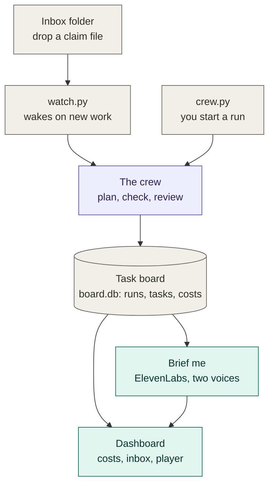
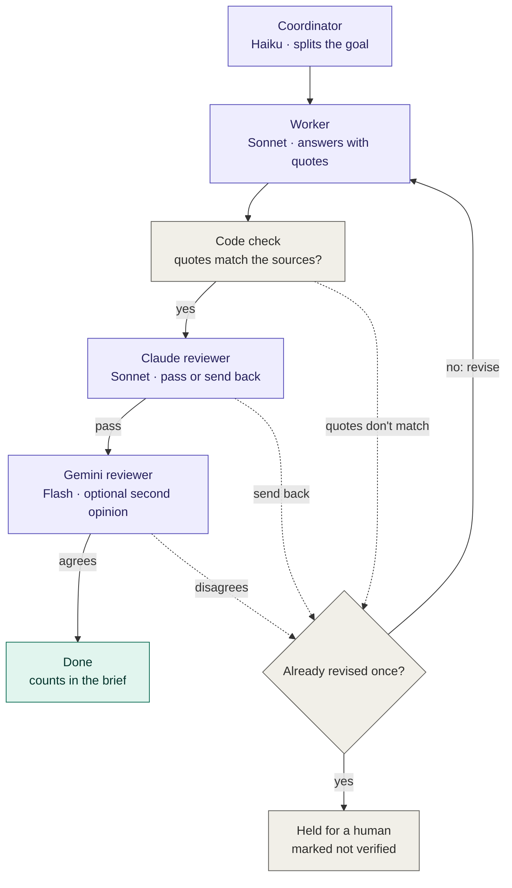
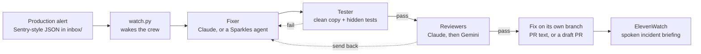

# build-night-crew

Pre-tested starter for Moonfire Build Night (22 Oct 2026): Claude agents with a shared task board, a per-run budget cap and live cost tracking. Work in progress.

On top of that base:
- **Always-on mode:** the crew waits for work in an inbox, wakes only when something arrives, recovers after a restart, and keeps to a daily spending cap.
- **An independent second reviewer:** Gemini re-checks every claim Claude passes, and a claim only counts if both agree.
- **SRE crew (Sparkles track):** a production alert wakes the crew, which fixes the bug, proves the fix with hidden tests and two reviewers, and leaves it on a branch for the engineer on call.
- **Brief me:** a spoken handover of what the crew did while you were away, written by code from the task board and read by ElevenLabs in two voices.


## How it works

Work comes in two ways: drop a claim file into the inbox (the watcher wakes the crew), or run `crew.py` yourself. Everything the crew does is recorded on the task board, which the dashboard and the spoken briefing read from.



Inside the crew, every claim goes through the same checks. Plain code checks the quotes before any reviewer sees them, and anything sent back gets one revision before it's held for a human.



Without `--gemini`, a pass from the Claude reviewer goes straight to Done. In challenge mode, a mistake is planted after the worker; the quotes stay real, so only a reviewer can catch it.

## Tested end to end (21 and 22 Oct 2026, real API calls)

| What | Result |
|---|---|
| Key check: Claude, Gemini (event key, plus backup model), ElevenLabs | All OK |
| Crew with Gemini as second reviewer, three claims | Gemini agreed on each; when Google returned "high demand", the claim was held as unverified, not passed. Retries and a backup model were added after this. |
| Always-on: a file dropped into `inbox/` | Picked up within seconds, checked, back to waiting (about 1p) |
| Stopped mid-run with Ctrl+C, then restarted | The cut-off run was marked interrupted and the work redone from the start as attempt 2, all three claims passed |
| The same file sent again | Ignored, nothing re-run |
| Two-voice briefing | Played in two voices; wording tightened after listening |
| Challenge mode with Gemini: a mistake planted on purpose | Claude caught it, the worker fixed it on attempt 2, Gemini agreed with the fix |
| `watch.py --gemini --brief`: a file dropped into `inbox/` | Checked in 10 seconds (about 1p), a two-voice briefing appeared in the dashboard's player 9 seconds later and played there |

Precisely what "always-on" means here: the watcher runs on one computer and waits for files in a local folder. It isn't yet deployed as a hosted service; running it in a cloud sandbox is the next step (see the experimental `sparkles` branch).

## Requirements

- [uv](https://docs.astral.sh/uv/) (Python 3.12 is installed automatically)
- Your own Anthropic API key
- Optional: a Gemini API key (a free Google AI Studio key works) for the second reviewer, and an ElevenLabs API key for spoken briefings

## Setup

```bash
git clone https://github.com/Csandal17/build-night-crew.git
cd build-night-crew
uv sync
```

Create a `.env` file in the project folder:

```
ANTHROPIC_API_KEY=your-key-here
GEMINI_API_KEY=optional
ELEVENLABS_API_KEY=optional
```

## Check your setup

```bash
uv run check_keys.py   # one tiny call per key: Claude, Gemini (model and JSON format), ElevenLabs (voices)
```

## Run the crew

```bash
uv run crew.py               # run the evidence crew on the default goal; writes a brief to output/
uv run crew.py --challenge   # plant one known mistake to prove the reviewer catches it
uv run crew.py --challenge --fast-reviewer   # same, with Haiku as the reviewer, to compare cost
uv run crew.py --gemini      # Gemini gives a second, independent review; a claim passes only if both agree
uv run dashboard.py          # open the live dashboard (keep it open while the crew runs)
```

With `--gemini`, Gemini only reviews work Claude has already passed, and never sees Claude's notes. If it disagrees, the worker revises once; if the reviewers still disagree, the claim is held for a human. If Gemini can't be reached, the claim is marked unverified rather than passed. Gemini calls go through the same budget check and cost tracking as Claude's (`gemini.py`).

For a clean demo, delete `board.db` first so the dashboard starts with no old runs.

The source pack lives in `sources/`: one `.txt` file per source, with header lines, then `---`, then the excerpt.

## Always-on mode

```bash
uv run watch.py   # waits for work in inbox/ and wakes the crew when something arrives (Ctrl+C to stop)
```

Plain code does the waiting, so a quiet inbox costs nothing. Drop a `.txt` file with a claim into `inbox/` and the crew picks it up within a few seconds. The same file is never run twice, an edited file counts as new work, and work cut off by a restart is picked up again. A daily cap (`DAILY_BUDGET_USD` in `watch.py`) stops new runs once today's spending can't cover another one.

A three-step demo, with the dashboard open:

```bash
# 1. Start the watcher in one terminal. The dashboard shows it waiting.
uv run watch.py

# 2. In a second terminal, give it work.
echo "Adults should consider taking a daily vitamin D supplement during autumn and winter." > inbox/vitamin-d.txt

# 3. Stop the watcher mid-run with Ctrl+C, start it again, and watch it pick the work back up.
#    Copy the same file under the same name again and nothing new runs.
```

`uv run watch.py --gemini` gives every claim the second review too, and `uv run watch.py --brief` makes a spoken briefing after each piece of work, ready to play on the dashboard. The options combine: `uv run watch.py --gemini --brief`.

## Brief me

```bash
uv run brief.py --dry-run   # print the briefing script: free, no audio
uv run brief.py             # hear what changed since your last briefing (plays on a Mac)
uv run brief.py --detail    # one line per claim with its reason, instead of grouped by verdict
```

A spoken handover for when you've been away. The script is written by code from `board.db`, not by a model, so it only says what actually happened: what arrived, each verdict, what a reviewer sent back, and what needs your decision. ElevenLabs reads it in two voices, a narrator for the crew and a second voice for the reviewers (falling back to one voice if two-voice dialogue isn't available on your plan). Each briefing stays under 2,000 characters, and audio is saved to `output/`.

The newest briefing also appears in a **Latest briefing** player on the dashboard (bottom left), with its script showing who says each line. The player sits outside the part of the page that refreshes, so a briefing keeps playing while the crew works, and a new one is tagged **New** until you press play. Browsers don't play sound on their own, so you press play.

## Sparkles writes the code, the crew checks it (experimental)

```bash
uv run sparkles_demo.py ~/sparkles-test "Add a function greet(name) to hello.py that returns 'Hello, <name>!'"
uv run sparkles_demo.py ~/sparkles-test "..." --gemini   # Gemini reviews the change too
```

A [Sparkles](https://sparkles.dev) coding agent makes the change through the Sparkles CLI (`sparkles exec`, driving your local Claude Code). Code checks something actually changed, Claude reviews the real diff (not the agent's description of it), and a reviewer's feedback goes back to Sparkles for one revision. Then it's done or held for a human. Nothing is committed or pushed.

Safety: the agent gets at most 6 turns and 5 minutes, may edit files but not run commands without approval, runs local-only, never sees the crew's API keys, and refuses to run in a folder that contains a `.env` file. Needs the Sparkles CLI (on your PATH, at `~/sparkles-cli/sparkles`, or set `SPARKLES_BIN`). The Sparkles agent runs on your own Claude Code plan, so its cost isn't shown on the dashboard.

## SRE crew: a production alert, fixed and proven (Sparkles track)

A production alert wakes the crew. One agent fixes the bug, another tests the fix with tests the fixer has never seen, and reviewers check it. Only then is it committed on its own branch with a pull request description. Nothing is merged: the engineer on call decides.



```bash
uv run sre_crew.py --reset                                        # fresh copy of the demo project, bug included
uv run sre_crew.py sre/alerts/checkout-keyerror.json              # one alert, start to finish
uv run sre_crew.py sre/alerts/checkout-keyerror.json --challenge --gemini
```

Always-on, with the dashboard open:

```bash
uv run watch.py --challenge --gemini --brief            # terminal 1: the crew waits for alerts
cp sre/alerts/checkout-keyerror.json inbox/             # terminal 2: production breaks
```

- **The demo project** (`sre/demo_app/`): a small shop checkout. Discount codes are looked up exactly as typed, so when the new mobile app sends `welcome10` instead of `WELCOME10`, checkout crashes. Its own tests all pass, which is how the bug reached production. `--reset` copies it to `~/sre-demo-app` (or `SRE_APP_DIR` in `.env`) as its own git repository, so no agent works next to the crew's API keys.
- **The alert** (`sre/alerts/checkout-keyerror.json`): what Sentry would send: the error, the stack trace, how many customers are affected, and the expected behaviour. Sentry's own webhook JSON is read too, so a real Sentry alert can be saved into `inbox/` the same way.
- **Hidden tests** (`sre/hidden_tests/`): the tester adds them to a clean copy of the fixed project, with no API keys in reach. The fixer only hears which behaviours failed, never the test code, so a pass means the fix works rather than being written to the test.
- **Challenge mode** shows why one agent isn't enough. The first fix is a planted shortcut, `DISCOUNTS.get(code, 0)`: the crash stops, but customers who type a valid code in lower case are quietly charged full price. The hidden tests catch it, the fixer is told exactly what failed, and the second fix passes.
- **Sparkles:** `--sparkles` makes a Sparkles coding agent the fixer (`sparkles_agent.py`). Moving to cloud sandboxes means changing `sparkles_agent.run()` for the fixer and `run_tests()` in `sre_crew.py` for the tester; nothing else changes.
- **Pull requests:** `--pr` pushes the fix branch and opens a draft pull request if the project has a GitHub remote and `gh` is installed. Without it, the pull request text is saved in `output/`.

Tested offline with stand-in model calls (35 checks): the planted shortcut caught and fixed, edits to tests ignored, a fix that never passes held with nothing committed, Gemini unavailable held as not verified, alerts and claims routed by the watcher.

## Crew feed: watch the agents talk

The dashboard's **Crew conversation** panel shows what the agents say to each other as it happens: who said it, to whom, what kind of message it is, and the evidence IDs it cites. Challenges are highlighted, so the audience sees agents disagree. The SRE crew posts to it automatically; any other agent posts with one line:

```python
from feed import post
post("Skeptic", "The disk warning started 28 hours before the first error.",
     to="Diagnostician", kind="challenge", evidence=["E2", "E1"])
```

From a terminal or another language:

```bash
uv run feed.py say Skeptic "The disk warning started 28 hours earlier." --to Diagnostician --kind challenge --evidence E2,E1
uv run feed.py demo    # a sample incident conversation, one message every 2 seconds
uv run feed.py clear   # empty the feed before a demo
uv run feed.py live    # keep the dashboard refreshing, for code that writes to board.db directly
```

Kinds: `alert`, `evidence`, `hypothesis`, `fix`, `challenge`, `reply`, `agree`, `verdict`, `note`. The feed stays on the newest message unless you've scrolled up to read, and new messages are highlighted as they arrive.

## What's in here

- `llm.py`: the only way agents call Claude. Timeouts, a per-run budget cap, and cost tracking on every call.
- `board.py`: a SQLite task board recording every run, task and model call, with its cost.
- `dashboard.py`: the live dashboard, which updates while a run is going.
- `crew.py`: the example crew. A coordinator splits the goal, workers check each claim against `sources/`, code checks every quote word for word, and a reviewer approves the work or sends it back once.
- `sources/`: the example source pack (NHS excerpts, checked against the live pages).
- `watch.py`: always-on mode. Watches `inbox/`, queues new work with a fixed ID, runs the crew one piece at a time, retries once, recovers after a restart, and keeps to a daily spending cap.
- `gemini.py`: Gemini as a second, independent reviewer, with the same budget check and cost tracking as `llm.py`.
- `brief.py`: the spoken briefing (ElevenLabs), written by code from the task board.
- `check_keys.py`: checks every API key with one tiny call each.
- `sparkles_agent.py`: a crew worker that writes code through the Sparkles CLI, with limits, no secrets, and the real change read from git.
- `sparkles_demo.py`: one request from start to finish: Sparkles codes, the crew reviews, one revision, then done or a human.
- `sre_crew.py` and `sre/`: the SRE crew, its demo project, sample alert and hidden tests.
- `feed.py`: the crew feed. Agents post messages; the dashboard shows the conversation live.

The first three files work for any crew. `crew.py` and `sources/` are the example to adapt or swap out.

## Licence

The code is MIT licensed (see `LICENSE`), so you're free to use and adapt it. The excerpts in `sources/` are short quotations from NHS web pages, not covered by that licence. Each file names its page and URL, and the text belongs to the NHS.
